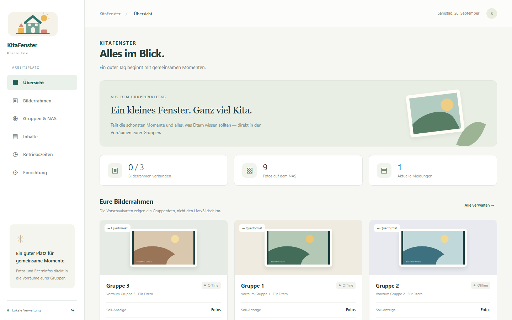
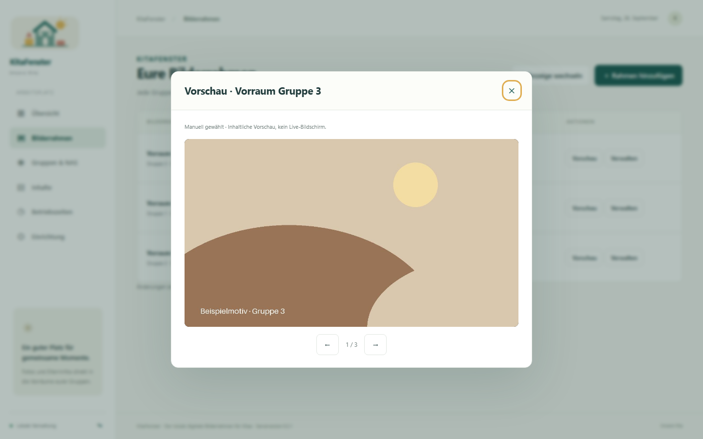
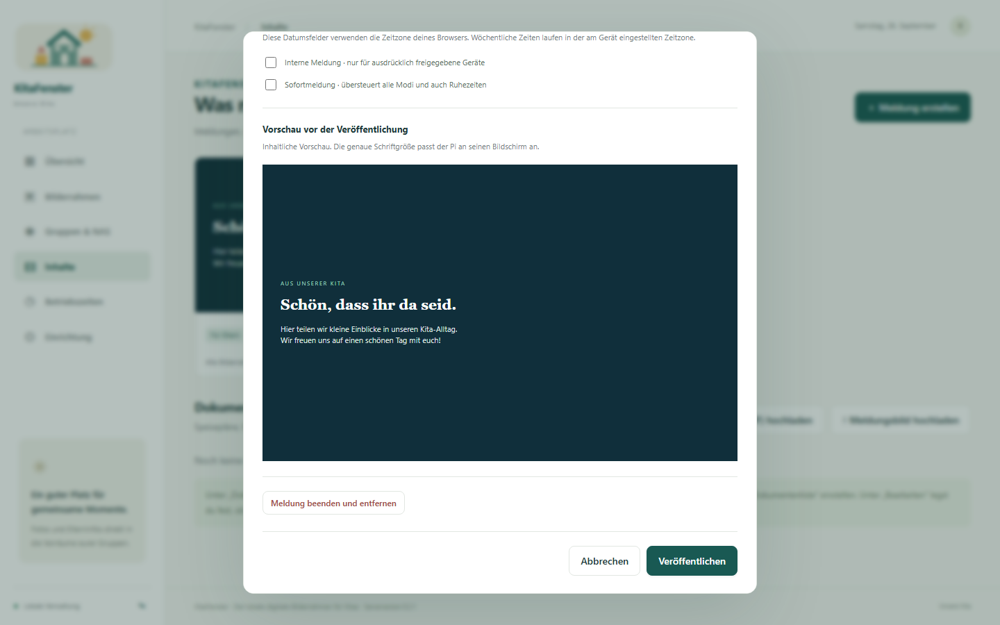
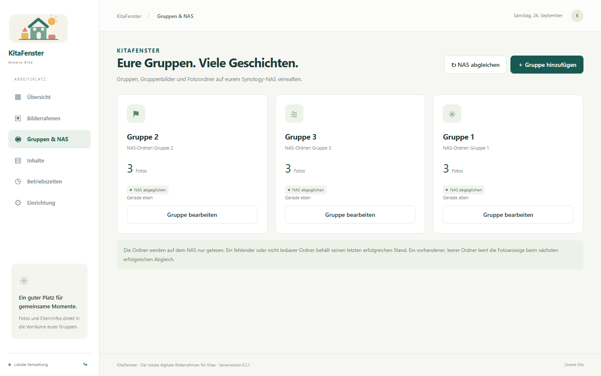
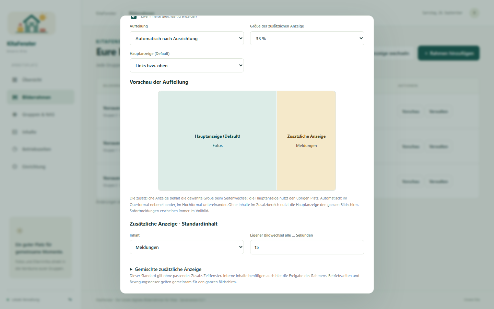
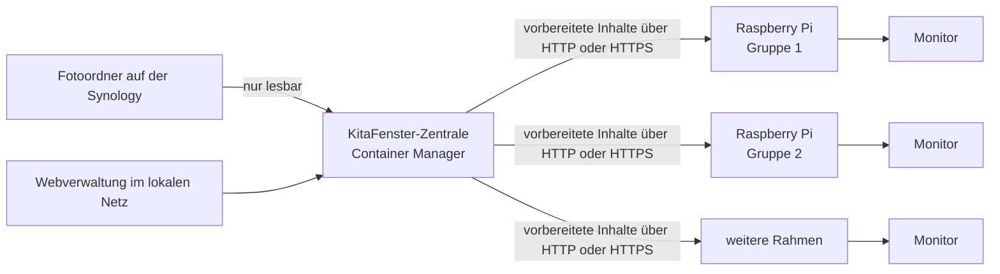

# KitaFenster

[](https://github.com/ALDevelope-code/KitaFenster/actions/workflows/container.yml)
[](https://github.com/ALDevelope-code/KitaFenster/releases/latest)
[](LICENSE)

**Projektversion im Quellcode: 0.2.4.** Das Release-Badge zeigt die zuletzt
veröffentlichte Version.

**Der lokale digitale Bilderrahmen für Kitas.**

KitaFenster ist ein selbst gehostetes Open-Source-Infosystem für
Kindertagesstätten. Eine Synology mit Container Manager verwaltet Fotos,
Dokumente und Meldungen. Raspberry Pis zeigen die zugewiesenen Inhalte an und
halten eine lokale Kopie für Netzwerkausfälle bereit. Ein Cloudkonto oder ein
Abonnement pro Bildschirm ist nicht erforderlich.

_Self-hosted, offline-capable digital signage for daycare centers, powered by
Synology and Raspberry Pi._

[Aktuelles Release](https://github.com/ALDevelope-code/KitaFenster/releases/latest)
· [Kurzanleitung](docs/KURZANLEITUNG.md)
· [Bedienung](docs/BEDIENUNG.md)
· [Problem melden](https://github.com/ALDevelope-code/KitaFenster/issues/new/choose)



## Was KitaFenster bietet

- **Lokaler Betrieb:** Die Zentrale läuft als Container auf dem eigenen
  Synology-NAS. KitaFenster benötigt keinen externen Cloud-Dienst.
- **Getrennte Gruppen:** Fotos, Dokumente und Meldungen lassen sich einzelnen
  Gruppen, Geräten oder allen Bilderrahmen zuordnen.
- **Offlinefähige Player:** Raspberry Pis laden vorbereitete Inhalte lokal und
  zeigen den letzten vollständigen Stand auch bei einem Netzwerkausfall.
- **Alltagstaugliche Inhalte:** Diashows, PDF-Dokumente, Elterninformationen,
  Meldungen und gemischte Wiedergabelisten werden unterstützt.
- **Zeit- und Energiesteuerung:** Zentrale oder gerätespezifische Betriebszeiten,
  Inhaltszeitfenster und optional ein HC-SR501-Bewegungssensor steuern die Anzeige.
- **Schutz interner Inhalte:** Als intern markierte Dokumente und Meldungen werden
  nur an ausdrücklich dafür freigegebene Geräte ausgeliefert.
- **Flexible Bildschirme:** Hoch- und Querformat, passende oder formatfüllende
  Fotos sowie eine Aufteilung in Haupt- und Zusatzanzeige sind möglich.

| Bildschirmvorschau | Meldung vor der Veröffentlichung |
|---|---|
|  |  |

| Gruppen und NAS-Ordner | Geteilte Anzeige |
|---|---|
|  |  |

[Alle Screenshots und passende Bildunterschriften](docs/screenshots/README.md)

## So ist KitaFenster aufgebaut



Die Pis benötigen keine SMB-Zugangsdaten. Sie fragen die Zentrale regelmäßig ab
und ersetzen ihren lokalen Stand erst nach einem vollständigen Download.

## Voraussetzungen und erprobter Stand

- **NAS:** Synology mit Container Manager und x86-64-Prozessor; entwickelt und
  geprüft für eine DS224+.
- **Player:** Raspberry Pi mit HDMI-Monitor sowie LAN oder WLAN. Erprobt ist ein
  Raspberry Pi 3 A+ mit Raspberry Pi OS Lite 32-bit auf Debian 13/Trixie und
  einem ASUS ZenScreen Go.
- **Verwaltung:** Ein aktueller Browser im lokalen Netz.
- **Einrichtung:** Grundkenntnisse in DSM, Netzwerk und Raspberry Pi sind für die
  Erstinstallation hilfreich. Die tägliche Inhaltspflege erfolgt anschließend
  über die Weboberfläche und die NAS-Ordner.

KitaFenster ist ein junges Projekt. Andere NAS-Modelle, Monitore, der
Dauerbetrieb und der Wiederanlauf nach Stromausfall müssen am jeweiligen Standort
geprüft werden. HDMI-Standby und Aufwachen unterscheiden sich je nach Monitor.
Der aktuelle Schwerpunkt liegt auf Fotos, PDF-Dokumenten und Textmeldungen;
Videos und HEIC-Dateien werden nicht unterstützt.

## Installation

Für eine Installation sollte ein versioniertes Paket aus den
[GitHub Releases](https://github.com/ALDevelope-code/KitaFenster/releases)
verwendet werden, nicht der wechselnde Entwicklungsstand des Standard-Branches.

1. NAS-Projekt und Bilderfreigabe anhand der
   [NAS-Installation](docs/INSTALLATION-NAS.md) einrichten.
2. Gruppen und Inhalte in der Webverwaltung konfigurieren.
3. Jeden Raspberry Pi anhand der [Pi-Installation](docs/INSTALLATION-PI.md)
   installieren und per PIN mit der Zentrale koppeln.

Der kompakte Gesamtweg steht in der
[Kurzanleitung für NAS, Pi und Monitorwechsel](docs/KURZANLEITUNG.md).

## Datenschutz und Sicherheit

KitaFenster hält Anwendungsdaten lokal auf dem NAS, bindet die Fotoordner nur
lesbar ein und benötigt für den Betrieb keinen externen Cloud-Dienst. Eigene
Fotos, Logos, Dokumente, Passwörter und Gerätedaten gehören in die vorgesehenen
Datenverzeichnisse und sind nicht Teil der veröffentlichten Pakete.

Die jeweilige Einrichtung bleibt für Einwilligungen, zulässige Inhalte,
Aufstellorte, Netzwerkabsicherung, Sicherungen und Löschfristen verantwortlich.
Die lokale Architektur allein ist keine pauschale Zusage rechtlicher
Konformität. Sicherheitsprobleme bitte entsprechend [SECURITY.md](SECURITY.md)
melden und nicht zusammen mit echten Kita-Daten veröffentlichen.

## Anleitungen

| Aufgabe | Anleitung |
|---|---|
| NAS über DSM/Container Manager einrichten, Rechte und `.env` | [NAS-Installation](docs/INSTALLATION-NAS.md) |
| Pi installieren, koppeln oder Monitor tauschen | [Pi-Installation](docs/INSTALLATION-PI.md) |
| Display bei Bewegung einschalten | [HC-SR501 anschließen und einstellen](docs/BEWEGUNGSSENSOR.md) |
| Inhalte, Bilderrahmen und Betriebszeiten verwalten | [Bedienung](docs/BEDIENUNG.md) |
| NAS sichern, Images aktualisieren und Pi-Updates durchführen | [Betrieb](docs/BETRIEB.md) |
| NAS-Fehler prüfen, bei Bedarf mit SSH | [NAS-Fehlersuche](docs/NAS-FEHLERSUCHE.md) |
| Tests und Abnahme am Standort | [Prüfungen](docs/TESTS.md) |
| Neue Projektversion veröffentlichen | [Releases](docs/RELEASES.md) |

## Technische Details

- **Zentrale:** Linux/AMD64-Container, FastAPI, SQLite sowie Bild- und
  PDF-Aufbereitung. Containerrechte werden über `NAS_UID`, `NAS_GID` und
  `NAS_READ_GID` festgelegt.
- **Player:** Python und Pygame mit direkter KMS/DRM-Ausgabe. Auf dem Pi werden
  weder Container noch Browser oder Desktop benötigt. Der systemd-Dienst
  `kita-player-kms.service` startet automatisch als Benutzer `frame`.
- **Formate:** JPG, JPEG, PNG, WebP und BMP sowie bis zu 30 Seiten pro
  PDF-Dokument.
- **Abgleich:** Standardmäßig scannt die Zentrale die NAS-Ordner alle 60 Sekunden;
  die Player gleichen ihren Stand alle 15 Sekunden ab.
- **Prioritäten:** Sofortmeldungen haben Vorrang vor Ruhezeiten, manueller Auswahl,
  Inhaltszeitfenstern und Standardinhalten.

## Downloads und neutrale Testdaten

Unter [GitHub Releases](https://github.com/ALDevelope-code/KitaFenster/releases)
enthält `kitafenster-nas-VERSION.zip` die NAS-Konfiguration und
`kitafenster-VERSION.zip` den vollständigen Quellcode mit Pi-Installer. Prüfsummen
stehen in `SHA256SUMS`.

Die [Testdaten für Gruppe 1 bis Gruppe 3](testdaten) enthalten beschriftete
Beispielbilder und fiktive Dokumente. Sie dürfen für eine Testinstallation und
Screenshots verwendet werden. Reale Kita-Daten gehören niemals in das Repository.

Die CAD-Quellen und Druckdateien für das optionale Monitorgehäuse stehen unter
[3D-Gehäuse: Druck und Montage](hardware/gehaeuse/README.md).

## Lokal unter Windows ausprobieren

```powershell
python -m venv .venv
.\.venv\Scripts\python.exe -m pip install -r requirements-server.txt
.\.venv\Scripts\python.exe -m pip install -e '.[player,test]'
.\tools\kitafenster-starten.bat
```

Danach `http://127.0.0.1:8088` öffnen. Das Startskript legt beim ersten Lauf eine
separate lokale Demo mit neutralen Beispieldaten an und zeigt die Zugangsdaten im
Konsolenfenster. Beenden lässt sie sich mit
`.\tools\kitafenster-stoppen.bat`. Die Verzeichnisse `local-data` und `local-nas`
sind von Git ausgeschlossen.

Der lokale Player kann nach einer PIN-Kopplung mit folgendem Befehl in einem
Fenster gestartet werden:

```powershell
.\.venv\Scripts\python.exe -m player --config player-data/player.json --windowed
```

## Mitmachen

Fehlerberichte, Rückmeldungen aus Testinstallationen und nachvollziehbare Pull
Requests sind willkommen. Bitte keine echten Kinderfotos, Zugangsdaten,
Datenbanken oder Protokolle mit personenbezogenen Angaben hochladen. Hinweise zum
Entwicklungsablauf stehen in [CONTRIBUTING.md](CONTRIBUTING.md).

## Lizenz

Copyright (C) 2026 Andy Lungfiel (ALDevelope-code).

KitaFenster steht unter **AGPL-3.0-only**. Siehe [LICENSE](LICENSE),
[Lizenzhinweise](docs/LIZENZ.md), [NOTICE](NOTICE) und
[Drittanbieter](docs/THIRD-PARTY.md). Eigene Kita-Logos, Fotos, Pläne und Texte
bleiben Inhalte der jeweiligen Einrichtung und werden durch die Projektlizenz
nicht zu Open-Source-Inhalten.
