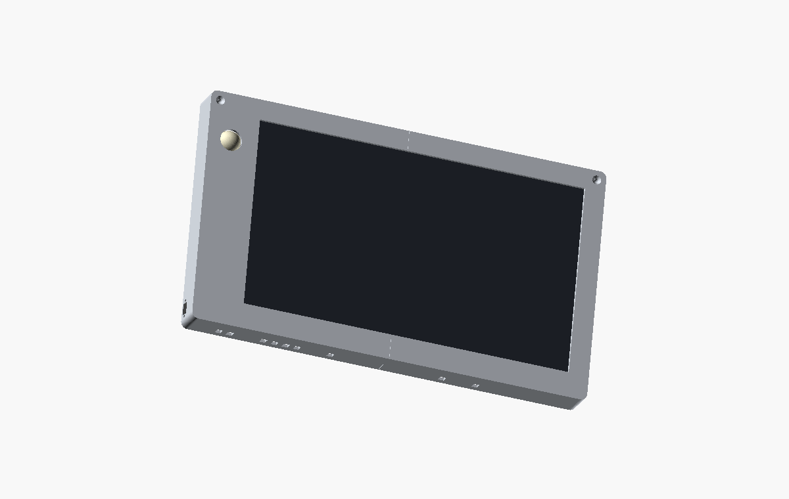
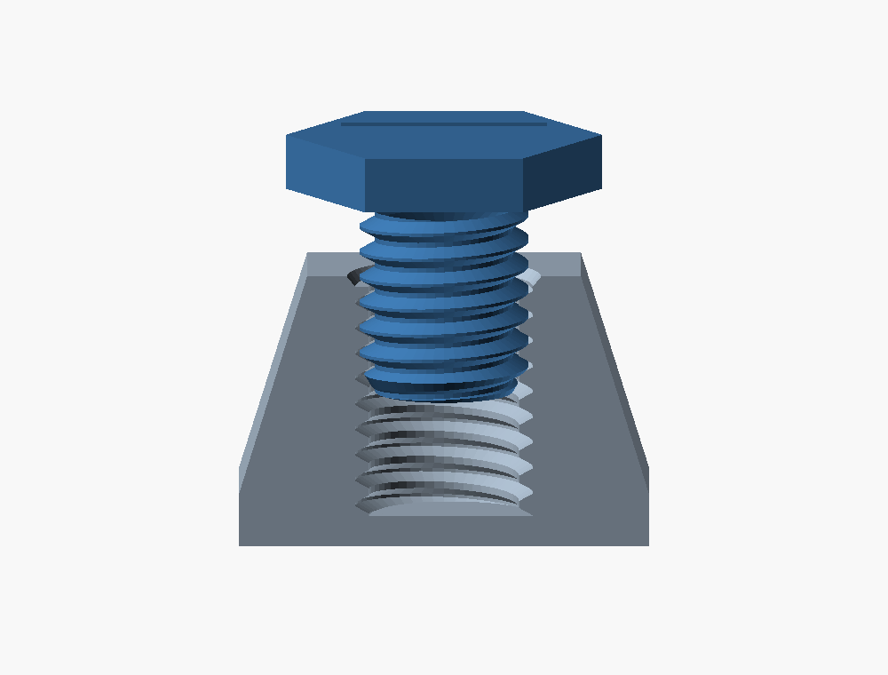
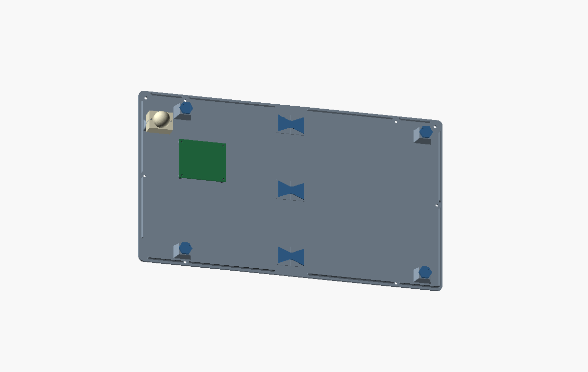
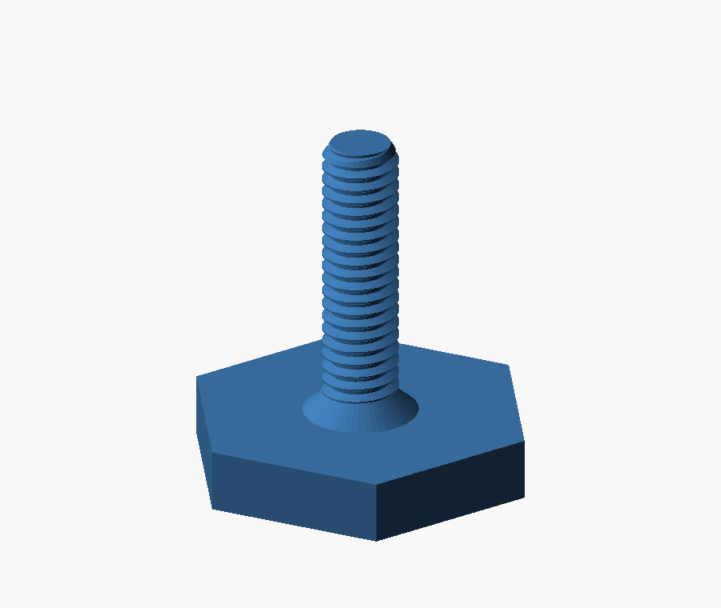

# Monitor-Wandgehäuse – Druck und Montage

Die ursprünglichen Konstruktions- und Druckdateien dieses Projekts stehen wie
der übrige Projektinhalt unter [AGPL-3.0-only](../../LICENSE); der
[Projekthinweis](../../NOTICE) beschreibt den Geltungsbereich.

Das Gehäuse nimmt einen Monitor mit 355,4 × 221 mm, einen Raspberry Pi 3 A+ und einen PIR-Sensor auf. Pi und PIR sitzen am abnehmbaren Deckel. Die Stromzuführung erfolgt mechanisch über eine seitliche USB-C-Panelbuchse.




## Dateien

- [Gesamtpaket mit CAD-Dateien, Druckteilen und Anleitung](gehaeuse_sketchup_und_druck.zip).

- [SketchUp geteilt](gehaeuse_geteilt.skp): Druckteile als einzelne Gruppen mit Bauteilreferenzen.
- [SketchUp komplett](gehaeuse_komplett.skp): durchgehende Front und Rückseite zum eigenen Teilen.
- [COLLADA geteilt](gehaeuse_geteilt.dae) / [komplett](gehaeuse_komplett.dae): Austauschformat.
- `stl_geteilt/`: für den P1S ausgerichtete Schalen, Keile und M10-Teller.
- `stl_komplett/`: ungeteilte Schalen ohne Nahttaschen; vor dem Druck selbst teilen und eine Verbindung ergänzen.
- `nachruestung_M4/`: optionaler M4-Teller für passende M4-Aufnahmen.
- [Parametrische Quelle](gehaeuse.scad): Bearbeitung mit OpenSCAD; benötigt `metric_threads.scad`.

Alle Maße sind in Millimetern. SketchUp-Gruppen mit `REFERENZ_` sind Platzhalter und werden nicht gedruckt. STLs enthalten ausschließlich Druckteile. Ungeteilte Schalen sind größer als das P1S-Druckbett.

## Maße und Einbauraum

| Merkmal | Maß / Ausführung |
|---|---|
| Gehäuse außen | **424,6 × 248,2 × 36 mm**, ohne Linse, Stecker und Schraubenköpfe |
| Monitor | 355,4 × 221 mm |
| Monitortiefe | untere 100 mm: 10,4 mm; obere 121 mm: 6,1 mm |
| Sichtfenster | 349,4 × 200 mm |
| Rahmenüberdeckung | unten 18 mm; links, rechts und oben je 3 mm |
| Acht Monitorführungen | mindestens 6 mm am Ansatz, 3 mm an der freien Kante |
| Untere Auflagen | für die vorhandenen 1-mm-Gummipads ausgelegt |
| Tastenfenster rechts | 94 mm hoch, von 3 bis 97 mm über Monitorunterkante; 13,4 mm tief |
| HDMI-Kabelraum links | grundsätzlich 47 × 141 × 18,4 mm; am USB-Flansch lokal eingeschränkt |
| Wandbefestigung | zwei Senkbohrungen von vorne, Abstand 404,6 mm |
| Deckel | 5-mm-Führungsrand mit 0,25 mm seitlichem Spiel; sechs Schrauben von hinten |

Die Monitorfront liegt auf einer gemeinsamen Ebene; die zusätzliche Dicke befindet sich auf der Rückseite. Führungen und Polster dürfen nur auf dem Monitorgehäuse aufliegen, nicht auf der Bildfläche.

## Druck auf dem Bambu Lab P1S

| STL in `stl_geteilt/` | Anzahl | Abmessungen in Drucklage |
|---|---:|---|
| [Front_1](stl_geteilt/Front_1.stl), [Front_2](stl_geteilt/Front_2.stl) | je 1 | 248,2 × 212,175 × 33 mm |
| [Rueckseite_1](stl_geteilt/Rueckseite_1.stl) | 1 | 248,2 × 212,175 × 24,4 mm |
| [Rueckseite_2](stl_geteilt/Rueckseite_2.stl) | 1 | 248,2 × 212,175 × 20,3 mm |
| [Klebekeil_Front](stl_geteilt/Klebekeil_Front.stl) | 4 | 40 × 12,13 × 2,6 mm |
| [Klebekeil_Deckel](stl_geteilt/Klebekeil_Deckel.stl) | 3 | 36 × 24,13 × 2,6 mm |
| [Andruckteller_M10](stl_geteilt/Andruckteller_M10.stl) | 4 | 18,48 × 16 × 15,2 mm |

Ein großes Teil pro Platte, Maßstab 100 %, exportierte Ausrichtung beibehalten. Front auf der Sichtseite, Rückseite auf der Wandseite. Keile mit Klebeflächen und Abstandspunkten nach oben; Teller auf der breiten Monitorseite, Gewindeschaft nach oben. Die 0,2-mm-Abstandspunkte der Keile müssen in der Schichtvorschau erhalten bleiben. Gedruckte Gewinde mit 0,12–0,16 mm Schichthöhe drucken; Teller massiv drucken.

Für das **256 × 256-mm-Bett** mit 18 × 28 mm Sperrfläche vorne links ist diese Platzierung einschließlich **2-mm-Außenbrim** geometrisch geprüft:

- Mittelpunkt der Modell-Hüllbox: **X = 128 mm, Y = 136,5875 mm**.
- Untere linke Ecke des Modells: X = 3,9 mm, Y = 30,5 mm.
- Fläche einschließlich Brim: X = 1,9–254,1 mm und Y = 28,5–244,675 mm.

Die Sperrfläche aktiv lassen. Größere Brims, Skirts und Stützen brauchen zusätzlichen Platz. In Bambu Studio Haftung, Überhänge und Entfernbarkeit von Stützen prüfen. Ein vollständiger Slicerlauf mit deinem Materialprofil ist nicht Bestandteil der CAD-Prüfung.

## Klebeverbindungen

Jede Schale besitzt eine senkrechte Links-Rechts-Naht. Vier kurze Keile verbinden die Front, drei den Deckel. Die Verbindung wird dauerhaft verklebt. Soll-Stoßfuge: **0,25 mm**; Bodenklebespalt unter den Keilen: **0,2 mm**.

Die Fronttaschen besitzen eine Breitenzugabe in Druck-Z. In der Quelle wird sie mit `front_pocket_z_extra = 0.4` als gesamte Zugabe zum parametrischen Grundprofil definiert. Taschenlänge und Einstecktiefe sind feste Maße. Beim Verkleben die Front ausrichten und fixieren; die Keile ersetzen keine Klemmung während des Aushärtens.

Stoßflächen und Taschen passend zum Kunststoff und Klebstoff vorbereiten. Hälften auf einer ebenen Unterlage ausrichten, Stoßflächen und Taschen verkleben, Keile einsetzen und bis zur vollständigen Aushärtung fixieren. Keile nicht mit Gewalt einschlagen. Der Deckelrand führt die Schalen beim Schließen; verschraubt wird von hinten bei abgenommenem Gehäuse.

## Monitorstützen und Polster

Vier gedruckte **M10 × 1,5-Teller** stützen die Monitorrückseite. Die Innengewinde besitzen 0,20 mm radiale Zugabe und 0,25 mm nominelles radiales Spiel zum Teller. Der Teller hat 9,90 mm Außendurchmesser, 12 mm Schaftlänge, einen 3,2 mm dicken Sechskant mit Schlüsselweite 16 mm und eine 0,2-mm-Polstertasche. Der Blindlochboden der Stützen ist mindestens 1,8 mm dick.

Teller am abgenommenen Deckel von der Monitorseite einschrauben, weiche Pads aufkleben und von Hand auf leichten, gleichmäßigen Kontakt einstellen. Die Deckelschrauben dürfen den Monitor nicht gegen zu weit herausstehende Teller verspannen. Der digital geprüfte Verstellweg beträgt jeweils eine Umdrehung hinein oder heraus, entsprechend ±1,5 mm um die Nennstellung.

| Weiche Pads, etwa 1 mm Gesamtdicke einschließlich Klebeschicht | Anzahl und Zuschnitt |
|---|---|
| Untere / obere Führungen | 2 × 14 × 8 / 2 × 14 × 4 mm |
| Linke Führung unten / übrige Seitenführungen | 1 × 8 × 8 / 3 × 8 × 4 mm |
| Untere / obere Frontlippe | 2 × 14 × 8 / 2 × 14 × 2 mm |
| Seitliche Frontlippe | 4 × 2 × 8 mm |
| Druckteller | 4 × 12 × 8 mm |

Taschen und vorgesehenes Spiel ergeben nominal 0,8 mm Einbauraum für weiche 1-mm-Pads. Schaumhärte und vorhandene Originalpads beim Einpassen berücksichtigen.



## USB-C, Pi und PIR

Die USB-C-Kupplung wird links unten von innen an die 3-mm-Seitenwand gelegt. Öffnung: **12,5 mm in Gehäusehöhe × 10,5 mm in Gehäusetiefe**; Mitte 18 mm über Gehäuseunterkante und 25 mm hinter der Vorderfläche. Zwei M3-Löcher stehen senkrecht mit **17 mm Abstand**. Zwei M3 × 6 mm werden von außen in die Gewinde der Buchse geschraubt.

Für die Buchse sind **30 mm Einbautiefe** und 15 mm zusätzlicher Leitungskorridor vorgesehen. Flansch-Platzreserve: 26 × 14 × 3 mm; Steckerform und Kabelknick am Bauteil kontrollieren. Die seitliche Lage verriegelt den USB-Stecker nicht.

Der Pi 3 A+ sitzt auf vier Abstandhaltern am Deckel, Bauteile zum Monitor gerichtet. Platine 65 × 56 mm, Lochabstand 58 × 49 mm, Abstandhalter 4 mm hoch. Bauteile einschließlich Stecker dürfen in der angesetzten Hülle maximal **16 mm** vor der Platine aufbauen; dann bleiben 1,7 mm Abstand zum Monitor. Höhere Kühlkörper oder Kabelbögen benötigen mehr Platz.

Der PIR sitzt links im Rahmen, Linse nach vorne. Zwei Stützen tragen ihn ausschließlich an den Platinenlöchern; bestückte Ecken bleiben frei. Arbeitsmaße: Platine 33 × 25 × 1,6 mm, Lochabstand **28 mm**, Frontöffnung Ø23 mm, 15 mm Bauteilraum dahinter. Zwei M2 × 6 mm und etwa 0,5 mm dicke Scheiben (Ø4,5 außen, Ø2,3 innen) von der Linsenseite einsetzen. Keine Senkköpfe in der Platine verwenden.

Das PIR-Kabel vollständig zwischen Pi und Sensor am Deckel führen. HDMI- und Stromleitungen zum Vorderteil brauchen eine spannungsfreie Serviceschlaufe. Beim Öffnen den Deckel abstützen und gerade abheben; beim Schließen die Linse gerade in die Öffnung führen.

Die interne elektrische Stromverteilung ist nicht Bestandteil des CAD-Modells. Dafür ist ein freier Raum von 80 × 50 × 17 mm vorgesehen; Verteilung und Modulhalterung hängen von den verwendeten Bauteilen ab.



## Schrauben und Montage

| Verbindung | Schrauben | Gewindeeinsätze / Aufnahme |
|---|---|---|
| Deckel | 6 × M3 × 8, Senkkopf 90° | 6 × M3; Aufnahme Ø4,1 × 5,2 mm |
| Monitorstützen | 4 × gedruckter M10-Teller | mitgedrucktes Innengewinde |
| Pi | 4 × M2,5 × 6 | 4 × M2,5; Aufnahme Ø3,5 × 4,5 mm |
| PIR | 2 × M2 × 6 mit Scheiben | 2 × M2; Aufnahme Ø3,2 × 3,2 mm |
| USB-C | 2 × M3 × 6, flacher Kopf | Gewinde der Kupplung |
| Wand | 2 × etwa Ø4 mm, Senkkopf | zur Wand passende Befestigung und Länge |

Die sechs Deckelschrauben sitzen paarweise oben, unten und mittig an den Seiten.
Die beiden seitlichen Schrauben liegen **124,1 mm über der Unterkante** und
jeweils **8 mm von der linken beziehungsweise rechten Außenkante** entfernt
(von vorne betrachtet: X = 8 und 416,6 mm). Die M3-Einsätze sitzen im Vorderteil;
der Deckel erhält passende Durchgangsbohrungen mit Senkung. Der linke
Gewindesitz liegt hinter dem freigehaltenen HDMI-Kabelraum.


Einsatzbohrungen sind Arbeitsmaße für die verwendeten Einsätze. Wandschraubenkanäle: Ø4,5 mm Durchgang, Ø9,4 mm Senkung; Mittelpunkte jeweils 10 mm unter Gehäuseoberkante und 404,6 mm auseinander.

1. Maße der realen Bauteile mit den angegebenen Einbaumaßen abgleichen und die Druckteile gemäß Stückliste drucken.
2. Front- und Deckelnähte ausrichten, dauerhaft verkleben und vollständig aushärten lassen.
3. Gewindeeinsätze und Polster montieren, USB-C-Kupplung befestigen und Monitor einlegen.
4. Pi und PIR am Deckel befestigen, Leitungen mit Reserve führen und M10-Teller einstellen.
5. Deckel aufsetzen, Polsterkontakt prüfen und mit sechs M3-Schrauben von hinten bündig schließen.
6. Das geschlossene Gehäuse über die beiden oberen Senkbohrungen an der Wand befestigen.

## Optionaler M4-Nachrüstsatz

Der [M4-Teller als STL](nachruestung_M4/Andruckteller_M4.stl),
[SketchUp-Datei](andruckteller_M4.skp) und [COLLADA-Datei](andruckteller_M4.dae)
ist für manuell geschnittene **M4 × 0,7-Gewinde** vorgesehen. Er gehört
**nicht in die M10-Aufnahmen des Gehäuses** und ist dort kein Ersatz für den M10-Teller.

Schaftlänge: 15 mm; Gesamthöhe: 18,2 mm; CAD-Außendurchmesser: 3,95 mm.
Bei Bedarf vier Teller drucken, mit der breiten Monitorseite auf dem Bett und
dem Gewindeschaft nach oben; massiv und mit 0,12–0,16 mm Schichthöhe.
Weiche Pads wie bei den M10-Tellern verwenden.

Eine passende Aufnahme benötigt eine für M4 vorgesehene Kernbohrung von
Ø3,4 mm. Nach dem Gewindeschneiden müssen ausreichend volle Gewindegänge
hinter dem Werkzeuganschnitt entstehen. Nicht gegen einen Blindlochboden
schneiden oder eine Rückwand durchbohren. Den Kunststoffschaft nur leicht
von Hand anlegen und den Monitor nicht verspannen.



## Prüfung und CAD-Quellen

Geprüft wurden geschlossene Netze, Abmessungen, Druckausrichtung, Bauteilüberschneidungen und Montagewege. Die Fronttaschen besitzen die festgelegte Breitenzugabe von 0,4 mm; alle vier M10-Aufnahmen haben 0,20 mm radiale Zugabe. SketchUp-Dateien wurden gespeichert, erneut geladen und gegen die exportierte Geometrie geprüft. Die digitale Prüfung bestätigt keine physische Tragfähigkeit, Werkstoffbeständigkeit oder Wandbefestigung.

Prüfberichte: [Geometrie](pruefung.txt), [Montage](kollisionspruefung.txt), [Frontpassung](frontpassung_pruefung.txt), [M10-Aufnahmen](deckelgewinde_pruefung.txt), [Gewinde](gewindepruefung.txt), [SketchUp geteilt](sketchup_pruefung_geteilt.txt), [SketchUp komplett](sketchup_pruefung_komplett.txt).

Die Maße stammen aus den angegebenen Bauteilmaßen und den gekennzeichneten Arbeitsmaßen. Gewindesteigung und Grundprofil orientieren sich an den [metrischen Gewindemaßen von TR Fastenings](https://www.trfastenings.com/knowledge-base/thread-geometries/metric-coarse-standard); Druckzugaben sind im Modell enthalten.

Zum Erzeugen der Dateien werden Python mit `numpy` und `manifold3d`, OpenSCAD und die lokale SketchUp-C-API benötigt. `metric_threads.scad` gehört zur Quelle; `export_sketchup.py` und `pruefe_geometrie.py` liegen im selben Verzeichnis.

```text
python build.py PFAD_ZU_OPENSCAD_COM [PYTHON_BIBLIOTHEKSORDNER]
python kollisionspruefung.py [PYTHON_BIBLIOTHEKSORDNER]
python pruefe_gewinde.py [PYTHON_BIBLIOTHEKSORDNER]
python pruefe_frontpassung.py [PYTHON_BIBLIOTHEKSORDNER]
python pruefe_deckelgewinde.py [PYTHON_BIBLIOTHEKSORDNER]
python export_native_skp.py [PYTHON_BIBLIOTHEKSORDNER] [PFAD_ZUR_SketchUpAPI.dll]
python render_ansichten.py PFAD_ZU_OPENSCAD_COM [PYTHON_BIBLIOTHEKSORDNER]
python pack.py
```

Das vorhandene, manuell eingerichtete Bambu-Studio-Projekt unter
`Bambu_Projekte/` enthält noch die Schalen ohne die beiden seitlichen
Deckelschrauben. Es bleibt wegen seiner individuellen Stützmarkierungen
unverändert und ist nicht im Gesamtpaket enthalten. Vor erneutem Druck
**Front_1, Front_2, Rueckseite_1 und Rueckseite_2** durch die aktuellen STLs
in `stl_geteilt/` ersetzen; anschließend Stützmarkierungen, Druckausrichtung,
Bettplatzierung und Schichtvorschau kontrollieren und neu slicen.
Die Klebekeile und Andruckteller sind unverändert.

[Dateiliste und SHA256-Prüfsummen](lieferumfang_sha256.json). Die ausgelieferten Gewinde sind rechtsgängig; Druckteile im Slicer nicht spiegeln.
